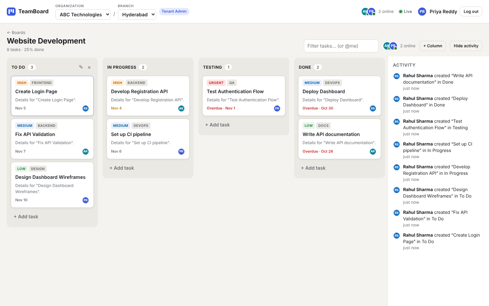

# TeamBoard — Real-Time Collaborative Kanban (MERN)

A multi-organisation, multi-tenant Kanban board built with **MongoDB, Express, React and Node.js**, with **Socket.IO** for live collaboration.
Employees of a company (e.g. *ABC Technologies*) work in branch workspaces (*Hyderabad, Bangalore, Chennai*); everyone on a board sees changes instantly, while each branch's data stays strictly isolated.



---

## 1. Project overview

| | |
|---|---|
| **Frontend** | React 18 + Vite, React Router, dnd-kit (drag & drop), Socket.IO client |
| **Backend** | Node.js + Express, Mongoose, Socket.IO, JWT, bcrypt, Zod |
| **Database** | MongoDB (8 collections) |
| **Real-time** | Tenant-scoped Socket.IO rooms, presence, editing indicators |

## 2. Business problem

ABC Technologies has several branches. Each branch runs its own projects on Kanban boards. People must be able to create, assign and move tasks together in real time — but a Hyderabad employee must **never** see Bangalore's private boards, and two people editing the same task at the same moment must **never** silently overwrite each other.

## 3. Features

- ✅ Registration & login (bcrypt-hashed passwords, JWT)
- ✅ Organisation selector and branch (tenant) switcher — lists come from the API, never hard-coded
- ✅ Three roles: **Org Admin**, **Tenant Admin**, **Member** — enforced on the backend for every REST call and socket action
- ✅ Full CRUD for organisations, tenants, boards, columns, tasks + membership management
- ✅ Kanban board with drag & drop (within and across columns, keyboard accessible)
- ✅ Optimistic UI with server reconciliation
- ✅ Live sync of every create / edit / move / delete across browsers
- ✅ Presence: who is online in the branch and who is viewing this board (multi-tab aware)
- ✅ "Priya is editing this task" soft-lock hints
- ✅ Optimistic concurrency control (`version` field, HTTP 409) with **automatic field-level merge** for non-overlapping edits and a manual resolution UI for real conflicts
- ✅ Activity log (board feed + per-task history), pushed live
- ✅ Automatic reconnect → re-authenticate → re-join room → resync board
- ✅ Live revocation: removing a member kicks their open sockets out of the room
- ✅ Board insights endpoint (counts per column, completion rate, overdue tasks)
- ✅ Seed data (2 orgs, 5 branches, 7 users, 27 tasks) and an automated isolation/concurrency test script

## 4. Technology stack — and why

| Choice | Why | Trade-off |
|---|---|---|
| **MongoDB + Mongoose** | Required by the MERN stack; flexible documents for task metadata and activity details; atomic single-document updates are exactly what optimistic locking needs. | No foreign keys — referential integrity and cascades are enforced in the service layer (`cascade.service.js`). |
| **Express** | Small, explicit middleware chain makes the security pipeline (auth → tenant → role) easy to read and audit. | Structure is self-imposed (routes / controllers / services / middleware). |
| **Socket.IO** | Rooms, acknowledgements, auto-reconnect and heartbeats out of the box. | Presence lives in process memory — scaling out needs the Redis adapter (see §17). |
| **JWT (Bearer)** | Stateless identity shared by REST and the socket handshake. | Stored in `localStorage` for simplicity → XSS-sensitive; production should use httpOnly cookies + refresh tokens. |
| **Version numbers** | Detect stale writes cheaply, no locks held. | Users occasionally see a conflict prompt (mitigated by auto-merge). |
| **Fractional positions** | A move writes **one** document instead of renumbering a whole column; no multi-document transaction needed. | Gaps shrink over time → occasional automatic rebalance. |
| **React + dnd-kit** | Component model + accessible, modern drag & drop. | — |

## 5. System architecture

```
┌────────────────────────── React (Vite) ───────────────────────────┐
│ Login · Org/Branch switcher · Kanban (dnd-kit) · Task panel ·      │
│ Presence · Activity feed                                           │
│   axios ──(Bearer JWT, X-Tenant-Id, X-Socket-Id)──┐                │
│   socket.io-client ──(auth.token, tenant:join)──┐ │                │
└─────────────────────────────────────────────────┼─┼────────────────┘
                                                  │ │
┌──────────────────── Node.js / Express ──────────┼─┼────────────────┐
│  REST /api  ◄───────────────────────────────────┘ │                │
│   requireAuth → requireTenant → requireRole → controller           │
│                          │  (writes DB, THEN emits)                │
│  Socket.IO  ◄────────────┼─────────────────────────┘                │
│   handshake JWT → tenant:join (membership check) → room tenant:<id> │
│   presence map · task:editing relay                                 │
└──────────────────────────┼──────────────────────────────────────────┘
                           ▼
                  MongoDB (8 collections)
```

**Life of a move** (Rahul drags "Create Login Page" to *In Progress*):

1. React moves the card immediately (optimistic) and sends `PATCH /api/tasks/:id/move { toColumnId, toIndex, expectedVersion }`.
2. `requireAuth` verifies the JWT; `requireTenant` checks Rahul's membership for the `X-Tenant-Id` branch.
3. The controller loads the task with `{ _id, tenantId }`, validates the destination column belongs to the same board **and** tenant.
4. The new position is computed from the column's **current** server state (server-authoritative ordering).
5. Atomic compare-and-set: `findOneAndUpdate({ _id, tenantId, version: expectedVersion }, { $set, $inc: { version: 1 } })`.
6. An activity log is written.
7. Only after the write succeeds, `task:moved` is broadcast to `tenant:<id>`.
8. Priya's browser applies it (if its version is newer than what it has); Rahul's browser confirms its optimistic state.

## 6. Multi-tenant architecture

**Organisation vs tenant.** An *organisation* is the company (billing/ownership boundary); a *tenant* is a branch workspace inside it (data boundary). Keeping them separate lets one company have many isolated workspaces and lets an org admin oversee all of them without being a member of each one.

**How `tenantId` is assigned.** Clients never choose the tenant of a new record. Controllers always copy `tenantId`/`organizationId` from `req.tenant` — the tenant the middleware has *verified* — and ignore any `tenantId` in the request body.

**How the active tenant is validated.** The client sends `X-Tenant-Id`. `requireTenant` (`backend/src/middleware/tenant.middleware.js`) calls `resolveTenantAccess(userId, tenantId)`, which grants access only if the user has
- an org-level `org_admin` membership in that tenant's organisation, or
- a tenant-level membership for that exact tenant.

A missing tenant and a foreign tenant return the same `403`, so tenant ids cannot be probed.

**How isolation is enforced in queries.** Every tenant-owned collection (`boards`, `columns`, `tasks`, `activity_logs`) has a `tenantId`, and every query includes it: `Task.findOne({ _id: id, tenantId: req.tenant._id })`. Looking up a Bangalore task id through a Hyderabad context therefore returns **404**. Related records are re-checked too — a task can only be created in a column that belongs to the same board *and* tenant; an assignee must have access to the tenant.

**How WebSocket rooms are scoped.** Sockets authenticate with the JWT at handshake. `tenant:join` runs the *same* `resolveTenantAccess` check before joining room `tenant:<id>`. A socket is in at most one tenant room; events are only ever emitted to tenant rooms. When a membership is removed, that user's live sockets are removed from the room immediately (`tenant:access-revoked`).

**Indexes** start with `tenantId` (e.g. `tasks: { tenantId, boardId, columnId, position }`) so tenant-scoped queries stay fast and a missing tenant filter would stand out in review.

## 7. Role-based access control

| Action | Member | Tenant Admin | Org Admin |
|---|:-:|:-:|:-:|
| View boards, tasks, activity, members of their tenant(s) | ✅ | ✅ | ✅ (all tenants of org) |
| Create / edit / move tasks | ✅ | ✅ | ✅ |
| Delete a task | own tasks | ✅ | ✅ |
| Create / edit / delete boards & columns | ❌ | ✅ | ✅ |
| Add members, change roles, remove members (tenant) | ❌ | ✅ | ✅ |
| Create / rename / delete tenants | ❌ | ❌ | ✅ |
| Rename / delete organisation, add org admins | ❌ | ❌ | ✅ |
| Create a new organisation | any authenticated user (becomes its Org Admin) |

Roles live in `memberships`. `tenantId: null` means an organisation-level membership (Org Admin). Effective role in a tenant = highest of the org-level and tenant-level memberships. Hiding buttons in React is only cosmetic — every rule above is checked server-side (`requireRole`, controller checks).

## 8. Database design

See **[docs/DATABASE.md](docs/DATABASE.md)** and the diagram **[docs/database-erd.png](docs/database-erd.png)**. Schema source: `backend/src/models/index.js`.

`Organization ─< Tenant ─< Board ─< Column ─< Task`, users connect through `Membership`, and `ActivityLog` records every change per tenant.

## 9. Real-time communication

See **[docs/WEBSOCKETS.md](docs/WEBSOCKETS.md)**.

- Server → client: `task:created|updated|moved|deleted`, `board:*`, `column:*`, `activity:created`, `presence:update|online|offline`, `task:editing`, `board:resync`, `tenant:access-revoked`.
- Client → server: `tenant:join` (with ack), `tenant:leave`, `presence:viewing`, `task:editing`.
- Clients apply an incoming task only if `incoming.version >= local.version`, so duplicate or out-of-order events are harmless.
- **Reconnect**: Socket.IO reconnects with back-off → the handshake re-verifies the JWT → the client re-joins its tenant room → the board is refetched. Events missed while offline are never assumed delivered.

## 10. Concurrency handling

| Scenario | What happens |
|---|---|
| Two users edit the **same task, different fields** | Second save gets `409`; the client sees the other user changed *other* fields and automatically re-applies its own changes on top of the latest version → both edits survive. |
| Two users edit the **same field** | Second save gets `409 VERSION_CONFLICT` + the current task; the panel shows *Load latest (discard mine)* or *Overwrite with mine*. Nothing is overwritten silently. |
| Two users **move the same task** at once | The conditional update matches for exactly one of them; the other gets `409`, and its card snaps to the authoritative position. |
| Two users **reorder different tasks** | Both succeed: each move writes only its own task, with a position computed from the server's current column state. |
| One user **edits while another deletes** | Save returns `404`; the panel closes with "deleted by someone else". |
| Panel open while someone else saves | Clean form → refreshes silently. Dirty form → banner "updated by someone else (vN)". |

The guarantee rests on MongoDB's atomic single-document `findOneAndUpdate` with `version` in the filter — no multi-document transaction (and no replica set) is required.

## 11. Installation and setup

**Prerequisites:** Node.js 18+ and MongoDB 6+ (local install, Docker, or a free MongoDB Atlas cluster).

```bash
# 1. MongoDB — pick one
docker compose up -d                # uses docker-compose.yml in this repo
# or run your own mongod / use an Atlas connection string

# 2. Install everything
npm run install:all                 # installs backend + frontend

# 3. Configure
cp backend/.env.example backend/.env      # edit MONGO_URI / JWT_SECRET if needed
cp frontend/.env.example frontend/.env    # optional

# 4. Demo data
npm run seed

# 5. Run API (port 5000) + web app (port 5173) together
npm run dev
```

Open http://localhost:5173 and sign in with a demo account (password **`Password@123`**):

| Email | Role | Scope |
|---|---|---|
| rahul@abc.example | Org Admin | ABC Technologies — all branches |
| priya@abc.example | Tenant Admin | ABC / Hyderabad |
| arjun@abc.example | Member | ABC / Hyderabad |
| sneha@abc.example | Tenant Admin | ABC / Bangalore |
| meera@abc.example | Member | ABC / Bangalore **and** Chennai |
| vikram@xyz.example | Org Admin | XYZ Solutions — all branches |
| kiran@xyz.example | Member | XYZ / Mumbai |

> **Demo tip:** open a normal window as Priya and an incognito window as Arjun on *Website Development* — drag cards, edit the same task, watch presence and the activity feed update live.

## 12. Environment variables

**backend/.env**

| Variable | Default | Purpose |
|---|---|---|
| `PORT` | `5000` | API port |
| `MONGO_URI` | `mongodb://127.0.0.1:27017/collaborative_kanban` | MongoDB connection string |
| `JWT_SECRET` | dev placeholder | **Must** be set in production (server refuses to start otherwise) |
| `JWT_EXPIRES_IN` | `7d` | Token lifetime |
| `CLIENT_ORIGIN` | `http://localhost:5173` | Comma-separated CORS / Socket.IO origins |

**frontend/.env**

| Variable | Purpose |
|---|---|
| `VITE_API_URL` | Leave empty locally (Vite proxies `/api` and `/socket.io`). Set to the API origin in production. |

## 13. Running the application

| Command (repo root) | What it does |
|---|---|
| `npm run dev` | API (nodemon) + web app (Vite) together |
| `npm run seed` | Wipe and reload demo data |
| `npm run test:isolation` | Automated tenant-isolation / RBAC / concurrency / WebSocket checks (API must be running) |
| `npm run build` | Production build of the frontend into `frontend/dist` |

Individually: `cd backend && npm run dev` and `cd frontend && npm run dev`.

## 14. API documentation

Full reference with request/response examples: **[docs/API.md](docs/API.md)**.

## 15. WebSocket events

Full reference with payloads: **[docs/WEBSOCKETS.md](docs/WEBSOCKETS.md)**.

## 16. Testing and validation

See **[docs/TESTING.md](docs/TESTING.md)** for the manual test plan. The automated script `backend/scripts/isolation-test.js` checks 26 cases, including:

- forged / missing tokens rejected; wrong password rejected
- a member only sees their own tenant; an org admin sees all tenants of their org
- switching `X-Tenant-Id` to another branch → 403; reading or modifying a foreign task by id → 404; creating a task on a foreign board → 404
- cross-organisation reads and tenant use blocked
- members cannot create tenants/boards; tenant admins cannot create tenants
- stale update → 409 with the current copy; simultaneous moves → exactly one wins
- a socket cannot join a foreign tenant room; Hyderabad events reach Hyderabad users only; presence online/offline events fire

The UI flows were also exercised in two headless browser sessions (drag & drop sync, quick-add sync, auto-merge, conflict banner, tenant switching); screenshots are in `/screenshots`.

## 17. Known limitations

- **Single API instance**: presence is held in memory. Multiple instances need `@socket.io/redis-adapter` and a shared presence store.
- **Token storage**: JWT in `localStorage` (simple, but XSS-exposed). No refresh tokens / revocation list.
- **Cascading deletes** are done in application code without a transaction; an interrupted cascade can leave orphans (harmless to isolation, since everything is still tenant-filtered).
- **Activity logs** are written after the main write; a crash in between loses that log line (not the change).
- Members are invited by email of an **already registered** user; there are no email invitations.
- No undo/redo, file attachments or comments.

## 18. Future enhancements

- Redis adapter + Redis-backed presence for horizontal scaling; sticky sessions behind a load balancer
- httpOnly cookie sessions with refresh-token rotation
- MongoDB transactions (replica set) for cascades and log-with-write atomicity
- Idempotency keys on create endpoints for safe client retries
- Undo/redo built on the activity log
- Optional Python (FastAPI) AI assistant using read-only, tenant-scoped tools on top of `/api/boards/:id/summary`
- Rate limiting, audit export, e-mail invitations, comments and attachments

---

### Repository layout

```
collaborative-kanban-mern/
├── backend/
│   ├── src/
│   │   ├── config/        env + MongoDB connection
│   │   ├── models/        8 Mongoose schemas + indexes
│   │   ├── middleware/    auth (JWT), tenant isolation, roles, errors
│   │   ├── controllers/   auth, organizations, tenants, boards, columns, tasks, activity
│   │   ├── services/      access (RBAC), activity log, cascades
│   │   ├── sockets/       Socket.IO server, rooms, presence, emitter
│   │   ├── utils/         validation (zod), errors, fractional ordering
│   │   ├── routes/        REST routes
│   │   ├── seed/          demo data
│   │   ├── app.js         Express app
│   │   └── server.js      HTTP + Socket.IO bootstrap
│   └── scripts/isolation-test.js
├── frontend/
│   └── src/
│       ├── context/       Auth, Workspace (org/tenant/socket/presence), Toasts
│       ├── hooks/         useBoard (state, real-time, optimistic moves)
│       ├── components/    Navbar, KanbanBoard, BoardColumn, TaskCard, TaskModal, ActivityPanel, MembersPanel, Avatar
│       ├── pages/         AuthPage, Dashboard, BoardPage
│       └── services/      api (axios), socket
├── docs/                  API.md, WEBSOCKETS.md, DATABASE.md, TESTING.md, database-erd.png
├── screenshots/
├── docker-compose.yml
└── package.json           root scripts
```
