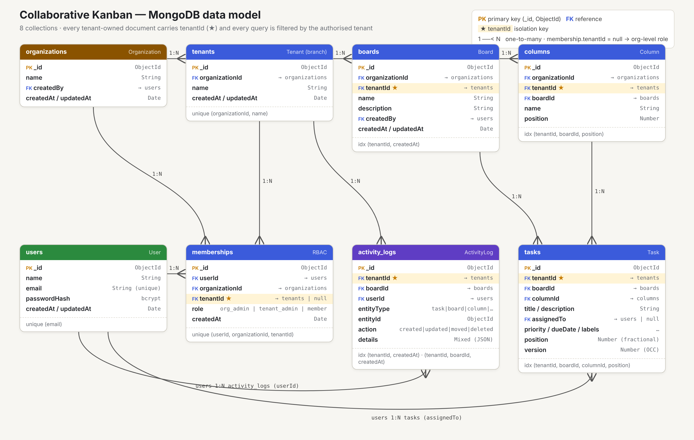
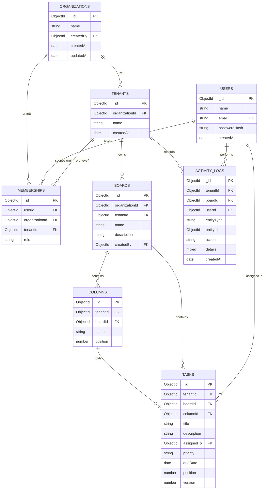

# Database design (MongoDB)

Source of truth: `backend/src/models/index.js`. Editable diagram source: `docs/erd-source.html` (open in a browser).

## Collections

| Collection | Purpose | Key fields | Indexes |
|---|---|---|---|
| `organizations` | Parent companies | `name`, `createdBy` | `_id` |
| `tenants` | Branches / workspaces | `organizationId`, `name` | `organizationId`; **unique** `(organizationId, name)` |
| `users` | Accounts | `email` (lower-case), `passwordHash` (bcrypt, never returned) | **unique** `email` |
| `memberships` | RBAC link user ↔ org/tenant | `userId`, `organizationId`, `tenantId` (null ⇒ org level), `role` | `userId`, `organizationId`, `tenantId`; **unique** `(userId, organizationId, tenantId)` |
| `boards` | Kanban boards | `tenantId`, `organizationId`, `name`, `description`, `createdBy` | `(tenantId, createdAt)` |
| `columns` | Status columns | `tenantId`, `boardId`, `name`, `position` | `(tenantId, boardId, position)` |
| `tasks` | Work items | `tenantId`, `boardId`, `columnId`, `title`, `description`, `assignedTo`, `priority`, `dueDate`, `labels`, `position`, `version`, `createdBy`, `updatedBy` | `(tenantId, boardId, columnId, position)`, `(tenantId, assignedTo)` |
| `activity_logs` | Audit / history | `tenantId`, `boardId`, `userId`, `entityType`, `entityId`, `action`, `details` | `(tenantId, createdAt)`, `(tenantId, boardId, createdAt)`, `(tenantId, entityId, createdAt)` |

Every collection has `createdAt` / `updatedAt` timestamps (activity logs: `createdAt` only).

## Design decisions

**Denormalised `tenantId` (and `organizationId`) on every tenant-owned document.** Columns and tasks could derive their tenant through their board, but storing it directly means *every* query can be a single filter `{ _id, tenantId }`. That makes isolation both cheap and easy to audit: any query without `tenantId` is a bug.

**References, not embedding.** Tasks are separate documents (not embedded in boards) so that concurrent edits touch different documents, versioning is per task, and a board does not grow without bound.

**Referential integrity in code.** MongoDB has no foreign keys, so the service layer:
- validates that referenced ids exist *in the same tenant* (column ∈ board ∈ tenant; assignee has tenant access),
- performs cascading deletes (`backend/src/services/cascade.service.js`),
- refuses to delete a column that still holds tasks.

**Ordering.** `position` is a floating-point number. Inserting between neighbours uses the midpoint, so a move updates one document. If neighbouring positions get closer than `1e-6`, the column is renumbered (1024, 2048, …) and clients get `board:resync`. Ties are broken by `_id` on both server and client.

**Concurrency.** `version` starts at 1 and is incremented by every update/move with an atomic conditional update (`{ _id, tenantId, version: expected }`). A failed match means a stale write → HTTP 409.

**Passwords.** bcrypt with cost 12 (`select: false` on the schema; stripped from JSON).
